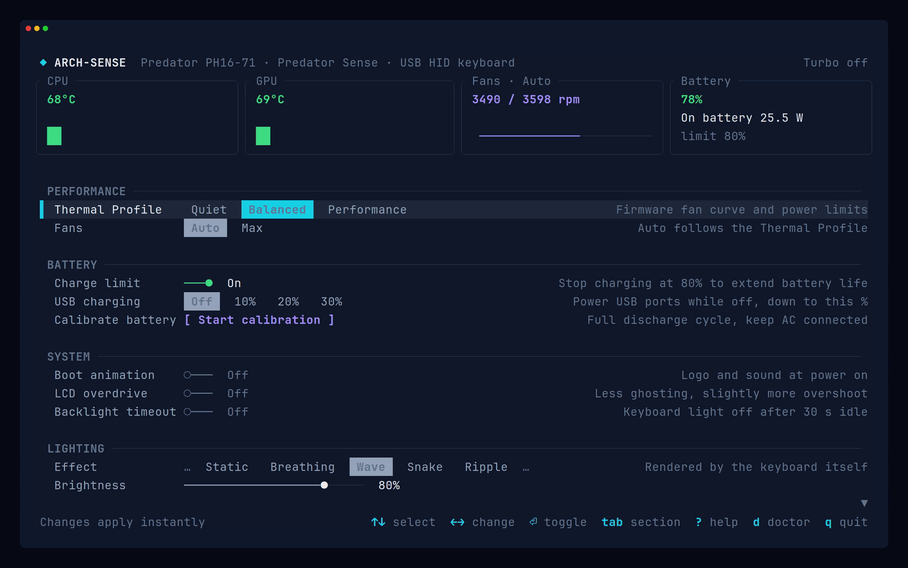

<div align="center">


# Arch-Sense

**PredatorSense for your Linux terminal.**

Thermal profiles, fans, battery care and keyboard RGB for Acer Predator and Nitro laptops.<br>
One AUR package, no sudo, and only the controls your laptop actually has.

[](https://github.com/CPT-Dawn/Arch-Sense/releases/latest)
[](https://github.com/CPT-Dawn/Arch-Sense/actions/workflows/check.yml)
[](https://aur.archlinux.org/packages/arch-sense)
[](LICENSE)

[Install](#install) · [Quick start](#quick-start) · [Documentation](docs/README.md) · [Contributing](CONTRIBUTING.md)



<sub><a href="assets/demo.mp4">Watch in full quality</a></sub>

</div>

## Why Arch-Sense

- **Only real controls.** It detects your laptop's Sense Interface and hides every control it lacks, so nothing on screen is a decoy.
- **No sudo, no setup.** The package ships a group and udev rules that grant write access to exactly the files it drives, and nothing else.
- **Two keyboard backends.** Four-zone RGB through Linuwu-Sense, plus the PH16-71's USB keyboard driven directly, with 13 effects.
- **A Doctor that names the fix.** `arch-sense doctor` checks the module, DKMS, Secure Boot, `acer_wmi`, permissions and lighting, and prints the command for anything broken.
- **Try it without the laptop.** `arch-sense --demo` runs the full app on a simulated PH16-71 and touches nothing. It's what the GIF shows.

## Install

```sh
paru -S arch-sense
sudo usermod -aG arch-sense $USER    # drive the hardware without sudo
reboot
```

You need an Acer laptop that [Linuwu-Sense](https://github.com/0x7375646F/Linuwu-Sense) supports, and your kernel's headers (for example `linux-headers`). The package pulls in `linuwu-sense-dkms-git`, which builds the kernel module for every installed kernel. Check [your keyboard](docs/hardware.md) for lighting support.

<details>
<summary>From source</summary>

Needs Rust (stable, edition 2024) and `libusb`. The AUR package also installs the group, udev rules and Boot Restore service from [`packaging/aur/arch-sense`](packaging/aur/arch-sense).

```sh
git clone https://github.com/CPT-Dawn/Arch-Sense && cd Arch-Sense
cargo build --release
```

</details>

## Quick start

```sh
arch-sense
```

1. Pick a setting with <kbd>↑</kbd> <kbd>↓</kbd> and change it with <kbd>←</kbd> <kbd>→</kbd>. It applies the moment you press the key.
2. Press <kbd>Tab</kbd> to jump to Lighting, where a live preview of your keyboard follows every change.
3. Press <kbd>d</kbd> if anything is missing: the Doctor tells you why and how to fix it.

Press <kbd>?</kbd> for every key. To keep your lighting across reboots, run `sudo systemctl enable arch-sense.service`.

## Documentation

| Guide | What it covers |
| --- | --- |
| [Installation](docs/installation.md) | Boot Restore, upgrading from v1, uninstalling |
| [Supported hardware](docs/hardware.md) | Which laptops and keyboards work, and what each gets |
| [Usage](docs/usage.md) | Every key, mouse action and command |
| [Troubleshooting](docs/troubleshooting.md) | Clang kernels, Secure Boot, permissions and other fixes |
| [Changelog](CHANGELOG.md) | What changed in each release |

## Contributing

Bug reports, keyboard captures and pull requests are welcome. [CONTRIBUTING.md](CONTRIBUTING.md) has the setup, the checks to run and how the demo is recorded.

Arch-Sense stands on [Linuwu-Sense](https://github.com/0x7375646F/Linuwu-Sense) by [@0x7375646F](https://github.com/0x7375646F), the kernel module that exposes the controls, and [ph16-71-rgb](https://github.com/Order52/ph16-71-rgb) by [@Order52](https://github.com/Order52), which documented the PH16-71 keyboard's protocol.

## License

[MIT](LICENSE) © 2026 Swastik Patel
